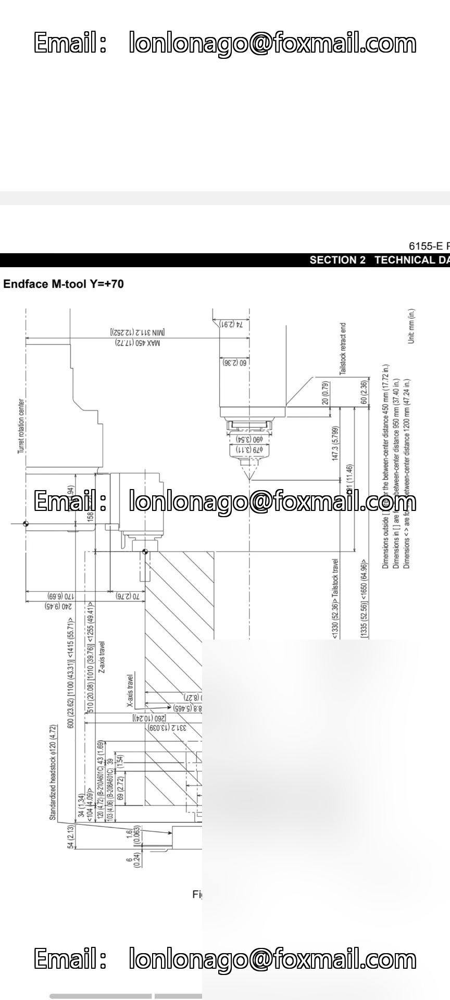
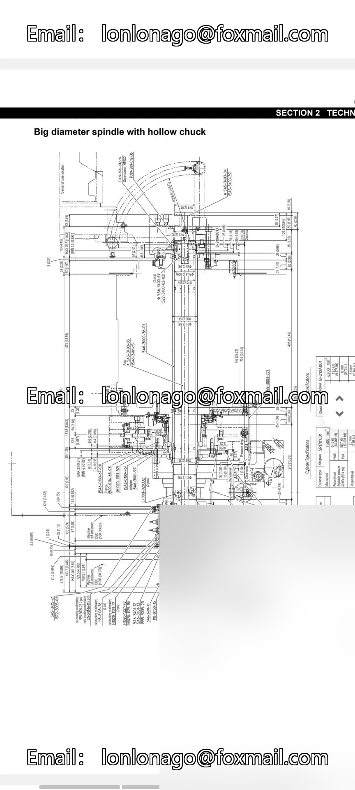
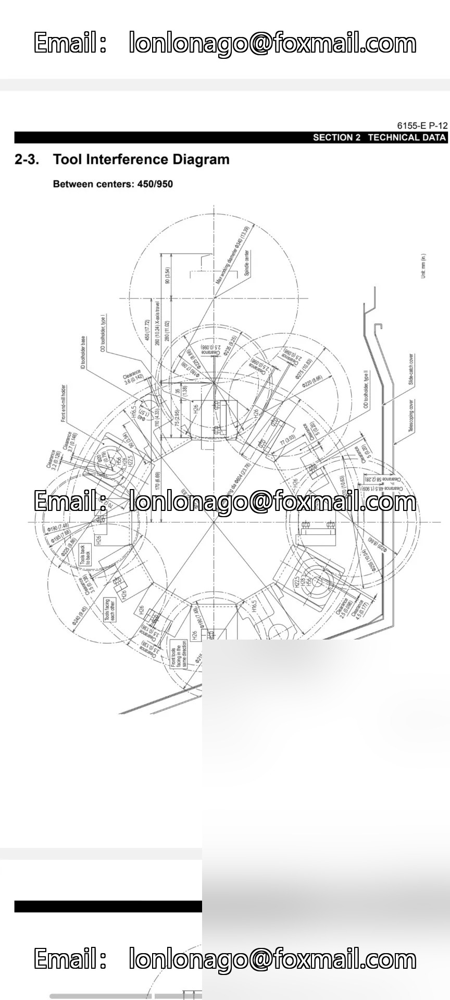
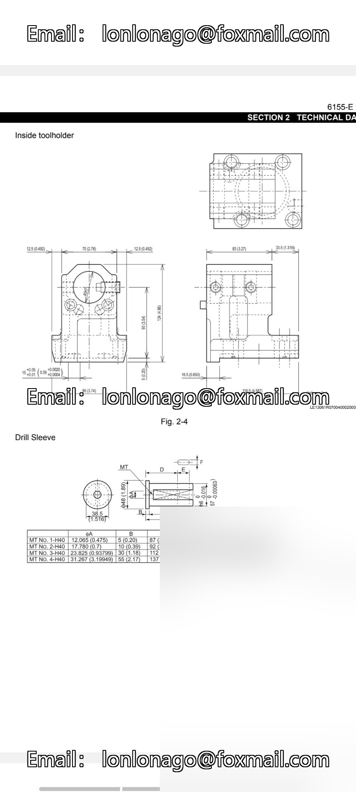

# Maho Space Turn LB3000

## Body

Okuma (Daoma) released the technical manual PDF e-book of 61 pages on the SPACE TURN LB3000 EX II series CNC lathes (lathes)

Combined with the introduction of Daima's product line and technical manual, SPACE TURN LB3000 EX II is a high-performance horizontal CNC lathe, usually known as "turning center".

Core purpose: It is mainly used for high-precision turning machining of rotating parts such as axles and disks. Since the model includes "MY", indicating that it also possesses an X-axis (transverse feed axis) and milling functions, and can complete various compound machining processes such as turning, milling, drilling, and drilling screws on one machine, especially suitable for processing irregular workpieces with complex shapes.

Typical industry applications: widely used in fields such as automotive manufacturing (e.g., propeller shafts, gear blanks), aerospace (precision components), mold manufacturing, and general mechanical processing.

returned on sale. To order directly, please contact via private messaging for issues.
4967

The document covers the technical manual PDF for the Okuma SPACE TURN LB3000 EX II series CNC lathe, with 61 pages, including technical parameters and a tool interference diagram.

<!-- AI_ENRICHED -->

## Images

## Payment

Here is a pay link on Stripe ( https://buy.stripe.com/3cs8yP7sY87d0vu9AB ). Please contact me lonlonago@foxmail.com after funding $89, and I will send you a complete data files , thank you!

